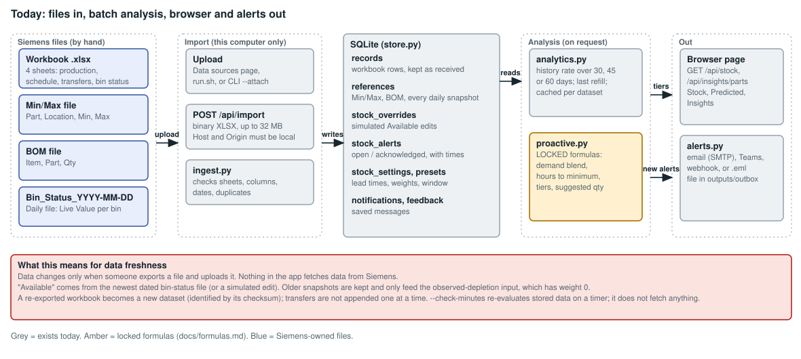
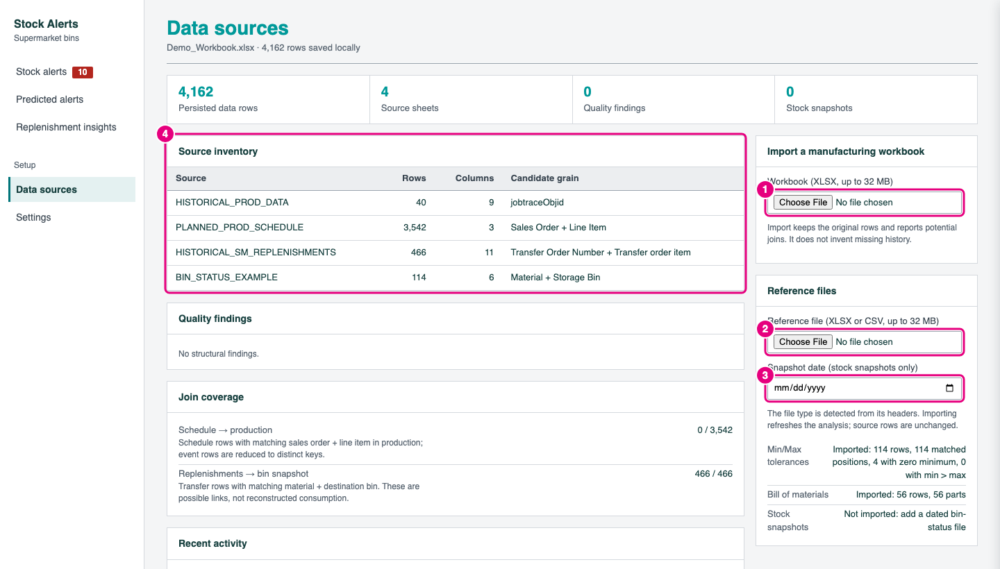

# Data import guide

How data gets into the app today, what each file must contain, what the app does with it, and the HTTP calls behind it. Audience: someone who has to compare this with a live data connection. For that comparison, read [Live data integration](LIVE_DATA_INTEGRATION.md) next.

Everything here describes the current prototype. Items marked **proposed** are not built.

## 1. The short version



- Data arrives as **files**: one manufacturing workbook (XLSX, four sheets) and up to three reference files (Min/Max, BOM, a daily bin-status file). A person exports them from Siemens systems and uploads them.
- The app keeps the original rows in SQLite and works out its numbers on request. Nothing is fetched from Siemens.
- "Available" stock comes from the **newest dated bin-status file**. A day-old file means day-old stock.
- Demand comes from the **replenishment transfers** in the workbook (history) and the **planned production** plus BOM (schedule).

## 2. What to load

| # | File | Format | Required columns | What it is used for |
| --- | --- | --- | --- | --- |
| 1 | Manufacturing workbook | XLSX, up to 32 MB | see the sheet table below | History rate, schedule rate, last replenished, refill flags |
| 2 | Min/Max tolerances | XLSX or CSV | `Part`, `Location`, `Min`, `Max` (`Type` optional) | The minimum and maximum of each bin |
| 3 | Bill of materials | XLSX or CSV | `Item`, `Part`, `Qty` | Turns planned production into per-part demand |
| 4 | Daily bin status | XLSX or CSV, named `Bin_Status_YYYY-MM-DD` | `Part`, `Location`, `Min`, `Max`, `Live Value` | Current stock ("available") |

Stock alerts need 1, 2 and a stock reading (4, or the `BIN_STATUS_EXAMPLE` sheet inside the workbook). The BOM adds the schedule rate; without it the forecast uses history only.

**The workbook** must contain these four sheets. A workbook missing a sheet or a required column is rejected with the message "This is not the manufacturing workbook … Nothing was imported."

| Sheet | Required columns | Also read | Key (one row per) |
| --- | --- | --- | --- |
| `HISTORICAL_PROD_DATA` | `salesorderOrdNr`, `productionorderSalesOrderLineItem`, `jobtraceObjid` | job and station timestamps, status | `jobtraceObjid` |
| `PLANNED_PROD_SCHEDULE` | `Sales Order`, `Line Item`, `Basic Start Date` | | `Sales Order` + `Line Item` |
| `HISTORICAL_SM_REPLENISHMENTS` | `Transfer Order Number`, `Transfer order item`, `Material`, `Dest.Storage Bin`, `Dest.target quantity` | `Creation Date`, `Creation time`, `Confirmation Date`, `Confirmation time`, `Dest. Storage Type`, `Source Storage Type` | `Transfer Order Number` + `Transfer order item` |
| `BIN_STATUS_EXAMPLE` | `Material`, `Storage Bin`, `Available stock`, `Base Unit of Measure` | `Storage Type`, `Material Description`, `Storage Unit`, `Special Stock Number` | material + storage bin + storage unit + special stock number |

## 3. How to load it

### In the browser

1. Open **Data sources**.
2. Under **Import a manufacturing workbook**, choose the workbook.
3. Under **Reference files**, choose the Min/Max file, then the BOM, then each daily bin-status file. Enter the **Snapshot date** for a daily file.
4. Check **Source inventory** (row counts per sheet), **Quality findings** and **Join coverage**.



### From the command line

```
python server.py --db new.sqlite3 --import-workbook data/Prod_Capstone_Data.xlsx \
    --attach data/Min_Max-SM.xlsx --attach data/BOMEXAMPLE.xlsx \
    --attach Bin_Status_2026-10-22.xlsx --as-of 2026-10-22 --quiet --no-serve
```

`--quiet` skips notifications. `--dataset <id>` attaches more files to an existing workbook later. `--no-serve` exits afterwards.

### Over HTTP

The browser uses this call. Any script on the same computer can use it too.

```
curl -X POST --data-binary @Prod_Capstone_Data.xlsx \
     -H 'Content-Type: application/octet-stream' \
     'http://127.0.0.1:8765/api/import?filename=Prod_Capstone_Data.xlsx'
```

| Part | Detail |
| --- | --- |
| Method, path | `POST /api/import` |
| Body | the file as raw bytes, `Content-Type: application/octet-stream`, 1 byte to 32 MB |
| Query | `filename` (used in the name), `dataset` (attach a reference file to this workbook dataset), `as_of` (`YYYY-MM-DD`, for daily bin-status files) |
| Workbook response | `201` and the dataset: `{id, name, kind: "workbook", created_at, checksum, ...}`. The id is `xlsx-` plus the first 16 characters of the file checksum. |
| Reference response | `201` and `{kind, dataset_id, rows, as_of, findings, notified, format?}` |
| Errors | `400` message in `{error}` (wrong file, nothing imported), `403` not a local request, `413` too large, `415` wrong content type |

The server accepts requests only when the `Host` header and any `Origin` header are `127.0.0.1` or `localhost`. There is no login.

## 4. What the app does with the data

### Positions

A **position** is one material in one storage type and bin. The app builds positions from the stock rows:

- Several storage units in the same bin are **summed** into one position, so each bin raises at most one alert.
- The minimum and maximum come from the Min/Max file, matched on material and bin (and storage type when both files carry it). No match, or an ambiguous match, gives the status *No tolerance*.
- Stock rows whose `Base Unit of Measure` is not `PC` or `EA` are counted as a quality finding, and their transfers do not produce a rate.
- A reading without a number gives *No stock*.

### Rates

- **History:** confirmed replenishment transfers, summed per position over the last 30, 45 or 60 days and divided by the window. Each transfer is matched to one position by material, bin and storage type; ambiguous matches are skipped and counted.
- **Schedule:** planned production lines for the next 30 days, multiplied by the BOM quantity per part, divided by 30. Parts shared by several positions, or missing from the BOM, get no schedule rate.
- **Observed:** average of the drops between consecutive dated snapshots. It has weight 0, so it does not affect results today.
- The blend and everything after it are the locked formulas in [formulas.md](formulas.md).

### Dates

Excel stores dates as day numbers and times as fractions of a day. The app converts them with the workbook's date system (1900 or 1904) and keeps them as local times. **The time zone of the confirmation times is not confirmed.** Dates are shown as local dates and times, not converted.

### Checks and findings

| Result | Examples |
| --- | --- |
| **Error: nothing is imported** | A required sheet or column is missing |
| **Warning: imported, shown under Quality findings** | Duplicate keys (identical duplicates count once, conflicting ones are skipped), missing keys, negative or zero quantities, non-numeric quantities, confirmation before creation, dates that cannot be read, unsupported units, Min/Max that disagree with a daily file (the tolerance file wins) |

### Re-importing

| Action | Result |
| --- | --- |
| Upload the **same workbook** again | Nothing changes. The id comes from the checksum, so the existing dataset is returned. |
| Upload a **different workbook** | A new dataset. Transfers are not appended to the old one. |
| Upload a Min/Max or BOM file | The newest file of that kind is used. Older ones stay stored. Analysis is recomputed. |
| Upload a daily bin-status file | Added as a snapshot for its date. The newest date sets "available". Older ones are kept. |
| Upload a **snapshot after alerts are open** | Alerts open, resolve or escalate on the next evaluation, and notifications go out (unless `--quiet`). |

## 5. Reading data back

| Call | Returns |
| --- | --- |
| `GET /api/health` | `{status: "ok", storage: "sqlite", mode: "local prototype"}` |
| `GET /api/datasets` | imported workbooks |
| `GET /api/sources?dataset=<id>` | sheet inventory, quality findings, join coverage, reference status, activity |
| `GET /api/stock?dataset=<id>[&window=30\|45\|60]` | every position with `available`, `min`, `max`, `status`, `forecast`, `hours_to_min`, `demand_per_day`, `suggested_qty`, `last_replenished`; plus open alerts, summary counts, settings and delivery channels |
| `GET /api/insights/parts?dataset=<id>` and `.csv` | parts with refill flags |
| `GET /api/feedback` | submitted feedback |

Alert and settings changes use `POST /api/stock/*` routes. They are listed in [alerts.md](alerts.md).

## 6. Handling Siemens data

- The repository is public. Never commit workbooks, databases, row-level examples or credentials. Keep them in the Git-ignored `data/` folder.
- Back up the database by copying `data/capstone.sqlite3` while the server is stopped.
- Source files are never modified. Edits to **Available** on the Stock alerts page are simulations stored separately and can be reset.

## 7. Open questions for Siemens

- What is the exact source system and refresh time of the daily bin-status file?
- What time zone are the creation and confirmation times in?
- Does the transfer export say who confirmed a transfer? (We would show it next to "Last replenished" if allowed.)
- Which unit conversions apply to parts that are not `PC` or `EA`?

## 8. Next: live data

Replacing the daily file with a live feed is not a small change in this prototype. What exists, what is missing, what we would add and what happens to the formulas is in [Live data integration](LIVE_DATA_INTEGRATION.md).
