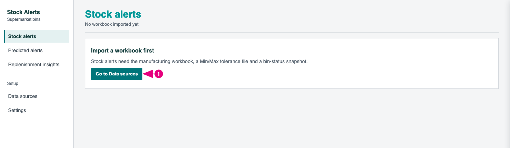
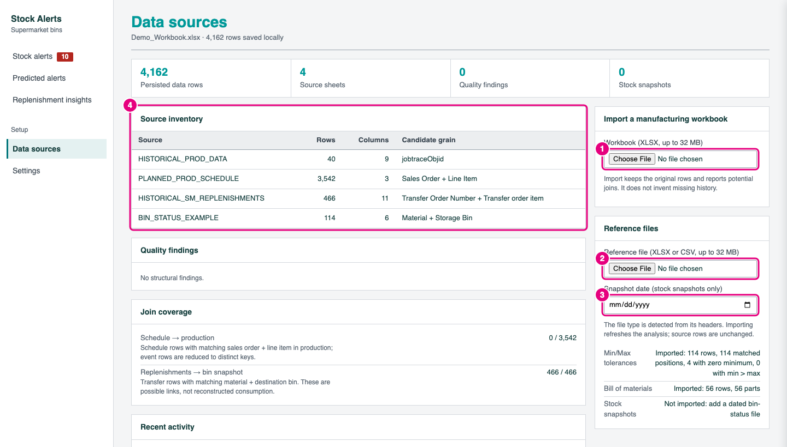

# Install guide

How to install and start the Siemens replenishment prototype on one computer, and how to load data into it. For what the screens mean, see the [User guide](USER_GUIDE.md).

The app is one Python process that serves one HTML page and keeps its data in one SQLite file. It listens on this computer only (`127.0.0.1`), has no login, and sends nothing over the network unless you configure email or a webhook.

## 1. What you need

| Item | Detail |
| --- | --- |
| Python | 3.11 or newer (`python --version`) |
| One Python package | `openpyxl`, installed from `requirements.txt` (needs internet access or an internal pip mirror) |
| A browser | Any current browser. Tested on Chromium. |
| The code | This repository, or the UAT zip |
| Siemens data (to see real results) | The manufacturing workbook, a Min/Max file and a BOM file. The daily bin-status files are optional. None are in the repository. See step 4. |

Only for running the tests or rebuilding the demo: `requirements-dev.txt` (`pytest`, `playwright`) and `python -m playwright install chromium`.

## 2. Install and start

Two ways to start. **Option A is the one to use** if you received the handoff zip. Option B rebuilds the database from the Siemens files (section 4 explains the loading steps).

### Option A (preferred): from the handoff zip

1. Unzip `siemens-capstone-handoff.zip`.
2. Open a terminal in the unzipped folder.
3. Run `sh run.sh siemens_capstone.sqlite3` (Windows: `run.bat siemens_capstone.sqlite3`).
4. Open http://127.0.0.1:8765.

Nothing to import: the zip's database already holds the workbook, the Min/Max file, the BOM and the alert history. The first start creates `.venv` and installs `openpyxl`.

### Option B: rebuild from the Siemens files

Put the workbook, the Min/Max file and the BOM in `data/` (daily bin-status files are optional), then:

```
python server.py --db data/new.sqlite3 --import-workbook data/Prod_Capstone_Data.xlsx \
    --attach data/Min_Max-SM.xlsx --attach data/BOMEXAMPLE.xlsx --quiet --no-serve
python server.py --db data/new.sqlite3
```

Or load the same files in the browser, as section 4 describes, starting from an empty database.

### Starting the app

**Windows:** double-click `run.bat`, or run `run.bat siemens_capstone.sqlite3` from a terminal.
**Mac / Linux:** in a terminal in the folder, run `sh run.sh siemens_capstone.sqlite3`.

The script creates a private `.venv` folder, installs `openpyxl` the first time, starts the server and opens your browser at **http://127.0.0.1:8765**. Keep the window open while you use the app. Close it, or press Ctrl+C, to stop.

**By hand** (works everywhere):

```
python -m venv .venv
.venv/bin/pip install -r requirements.txt          # Windows: .venv\Scripts\pip
.venv/bin/python server.py                         # Windows: .venv\Scripts\python server.py
```

Then open http://127.0.0.1:8765.

**Options**

| Option | Meaning |
| --- | --- |
| `--port 8766` | Use another port (default 8765) |
| `--db my_copy.sqlite3` | Use another database file (default `data/capstone.sqlite3`) |
| `--check-minutes 15` | Re-check stock alerts every 15 minutes (default off) |

With the scripts the options are positional: `run.sh my_copy.sqlite3 8766`. Without a database argument they use `siemens_capstone.sqlite3` next to them. They never create an empty database.

A new database is empty. The first screen asks for data:



1. Click **Go to Data sources** (or open it from the menu) to load data.

## 3. Check that it works without Siemens data

You can try the whole app with invented data and no setup:

```
.venv/bin/pip install -r requirements-dev.txt
.venv/bin/python scripts/build_demo_html.py
```

Open `outputs/Siemens_Replenishment_Demo.html` in a browser. It is a single file with a practice copy of the app. Nothing is saved or sent.

## 4. Load data

Open **Data sources**. Load files in this order.



1. **Workbook.** Choose the manufacturing workbook (XLSX, up to 32 MB). It needs these sheets: `HISTORICAL_PROD_DATA`, `PLANNED_PROD_SCHEDULE`, `HISTORICAL_SM_REPLENISHMENTS`, `BIN_STATUS_EXAMPLE`. The original rows are kept as they are.
2. **Reference files.** Choose each file (XLSX or CSV, up to 32 MB) in the same box, one at a time. The type is detected from its headers.
   - **Min/Max tolerances:** minimum and maximum per bin.
   - **Bill of materials (BOM):** parts per product.
   - **Daily bin-status files (optional):** `Bin_Status_YYYY-MM-DD.xlsx`. Add them to keep stock current after the workbook was exported. Enter each file's date in **Snapshot date** first.
3. **Source inventory** (4) lists the loaded sheets with row counts. Check that the numbers look right. The page also shows join coverage and any quality findings.

Stock alerts need the workbook and a Min/Max file. Stock comes from the workbook's `BIN_STATUS_EXAMPLE` sheet unless a daily bin-status file is added; a daily file then overrides it. The BOM is needed for the schedule part of the forecast. Importing again refreshes the analysis; the source rows are unchanged.

**From the command line** (same result, useful for scripting):

```
python server.py --db new.sqlite3 --import-workbook data/Prod_Capstone_Data.xlsx \
    --attach data/Min_Max-SM.xlsx --attach data/BOMEXAMPLE.xlsx \
    --quiet --no-serve
# optional daily file: add  --attach Bin_Status_2026-10-22.xlsx --as-of 2026-10-22  to the command
```

`--quiet` loads the files without sending notifications. `--no-serve` exits afterwards. Then start normally with `--db new.sqlite3`.

## 5. Optional: send alerts by email, Teams or a webhook

By default alerts are not sent. They are saved as `.eml` files in `outputs/outbox`, and **Delivery** on the Stock alerts page shows "Email not configured (saved to outbox)".

Set environment variables **before** starting the server. They are read at start-up.

| To send | Set |
| --- | --- |
| Email | `SMTP_HOST`, `SMTP_PORT` (587 by default), `SMTP_USER`, `SMTP_PASSWORD`, `ALERT_EMAIL_FROM`, `ALERT_EMAIL_TO` (comma-separated). TLS is on by default; set `SMTP_SSL=1` for port 465. |
| Teams | `TEAMS_WEBHOOK_URL`, a Workflows webhook. Steps are in [teams-setup.md](teams-setup.md). Teams was drafted but not tested end to end. |
| Any other system | `ALERT_WEBHOOK_URL`, a generic webhook |

Example (Mac / Linux):

```
export SMTP_HOST=smtp.example.com SMTP_USER=alerts@example.com SMTP_PASSWORD='...' ALERT_EMAIL_TO=a@example.com,b@example.com
.venv/bin/python server.py
```

Then use **Send digest** on Stock alerts to test. Every variable, the message formats and failure behaviour are in the [Notification guide](NOTIFICATION_GUIDE.md). The app refuses to send an SMTP password without TLS. Never commit credentials.

Forecast defaults can also be set before start-up with `LEAD_HOURS_*` and `ALERT_SAFETY_HOURS`. The usual way is the Settings page.

## 6. Where things are stored

| What | Where |
| --- | --- |
| Data, alerts, settings, feedback | The SQLite file (`data/capstone.sqlite3` by default). Back it up by copying it while the server is stopped. |
| Email copies | `outputs/outbox/` |
| Siemens files | Keep them in `data/`, which is ignored by Git. The repository is public. |

To start again from nothing, stop the server and delete the database file.

## 7. Troubleshooting

| Symptom | Fix |
| --- | --- |
| "Python was not found" | Install Python 3.11+ (tick "Add to PATH" on Windows) |
| pip cannot download | Point pip at your internal mirror (`pip config set global.index-url ...`) |
| "Cannot listen on port 8765" | Another program uses it. Start with `--port 8766` |
| "Database not found" (scripts) | Put `siemens_capstone.sqlite3` next to the script, or pass a path |
| Blank page or "unavailable" | The server window must still be open. Reload the page. |
| "Import a workbook first" | Load the workbook and a Min/Max file (step 4). The page's text also mentions a bin-status snapshot; that is not required. |
| Import looks wrong or incomplete | Open **Quality findings** on Data sources: it lists missing sheets or columns. Check the sheet names in step 4 and the file size (32 MB limit). Column details: [Data import guide](DATA_IMPORT_GUIDE.md). A workbook missing a required sheet or column is rejected with a message and nothing is imported. |

## 8. Run the tests

```
.venv/bin/pip install -r requirements-dev.txt
.venv/bin/python -m playwright install chromium
.venv/bin/python -m pytest -q                # add -m 'not browser' to skip browser tests
```

More detail on how the code is organised: [architecture.md](architecture.md). Formulas (locked): [formulas.md](formulas.md).
