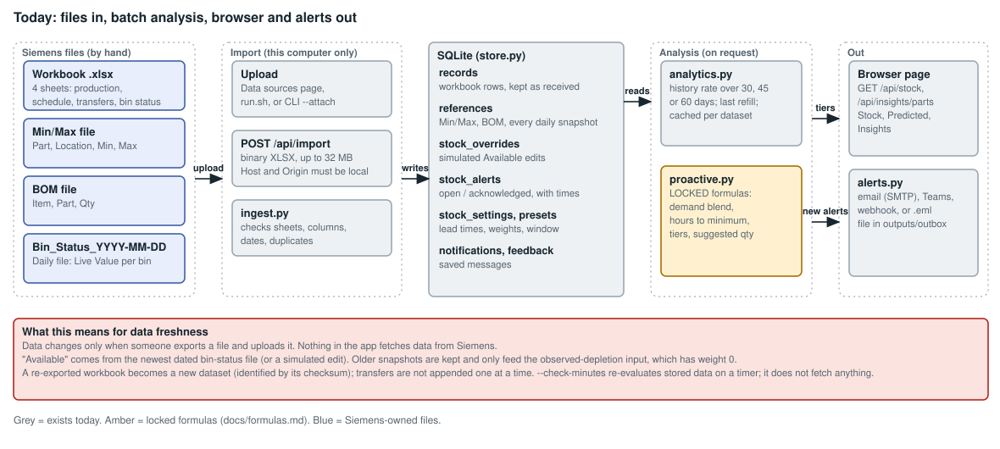
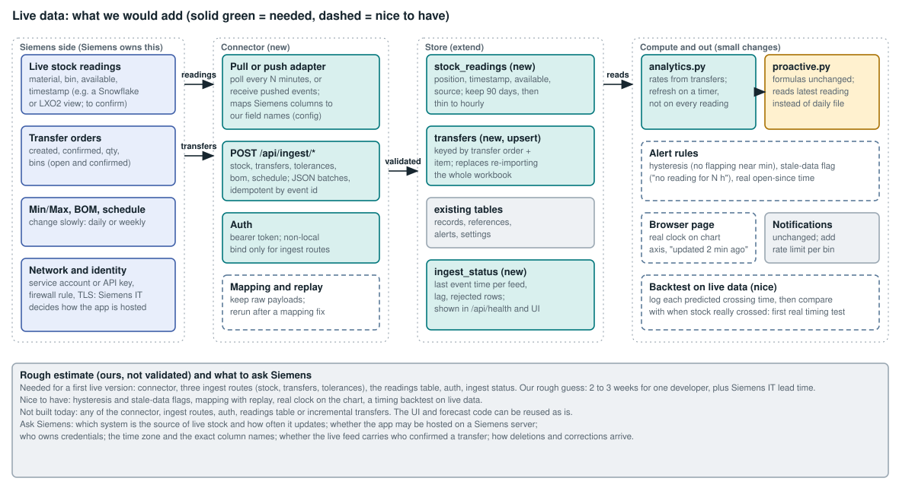
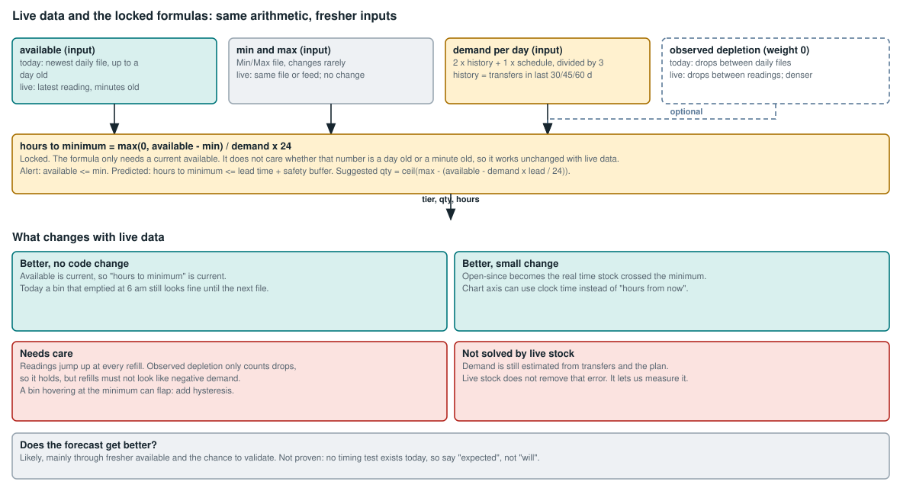

# Live data integration

Siemens wants to compare how the prototype gets data with how a live data connection would work. This page answers four questions:

1. How does the app talk to data today?
2. Is it ready for live data? (No. What exists and what is missing.)
3. What would we add, and what would be nice to have?
4. Do the locked formulas still work with live data?

Status: assessment and proposal. Nothing in sections 3 and 5 is built.

## 1. How the app talks to data today



Data moves in one direction and only when a person starts it: export a file from Siemens, upload it, and the app stores and analyses it. The app never calls a Siemens system. "Available" stock is the newest dated bin-status file, so the freshest stock the app can show is as old as the last upload. Details of each file and call are in the [Data import guide](DATA_IMPORT_GUIDE.md).

## 2. Is it ready for live data?

**No.** The forecast and the screens are reusable. The data path is not. Here is what exists and what does not.

| Need | Today | Gap |
| --- | --- | --- |
| Receive data without a person | Only `POST /api/import` (a binary XLSX, 32 MB, one file per call) | No JSON ingest, no batches, no event ids, no incremental updates |
| Accept calls from another machine | The server refuses any request whose `Host` or `Origin` is not `127.0.0.1` or `localhost`, and binds to loopback | Needs an authenticated route that remote callers may use, and a way to host the app on a server |
| Authentication | None (single user, local) | A token or service identity for ingest routes |
| Store stock over time | `references` keeps one JSON blob per daily file. Only the newest sets "available" | A readings table (position, time, available) with retention |
| Store transfers incrementally | The workbook's rows are stored per dataset. A different workbook is a new dataset | Upsert by transfer order and item |
| Keep analysis fresh | Analysis is cached per dataset and cleared on every import | A timed refresh, so a stream of readings does not recompute transfer rates each time |
| Know the feed is healthy | `GET /api/health` returns a fixed "ok" | Last event time, lag and rejected rows per feed |
| A place to plug in a Siemens source | None. There are no connector stubs or adapter interfaces | An adapter with a field mapping |
| Alert behaviour on a noisy feed | Alerts open and resolve on every evaluation | Hysteresis, a stale-data flag |
| Real clock | The chart axis is "hours from now" because the daily file has no time of day | Timestamps on readings |

What can be reused without change: the forecast code (`proactive.py`), the tiers and settings, the alert lifecycle and notification channels, every page of the UI, the analytics for transfer rates, and the read APIs (`GET /api/stock` and the others).

## 3. What we would add



**Needed for a first live version** (solid green in the picture):

| Piece | What it does |
| --- | --- |
| Connector | Pulls from a Siemens source every N minutes, or receives pushed events. Maps Siemens column names to ours through a config file. |
| `POST /api/ingest/stock`, `/transfers`, `/tolerances` | Authenticated JSON routes. Batches of readings or events, idempotent by an event id. |
| Auth | A bearer token for ingest routes. Everything else stays local-only unless Siemens decides how the app is hosted. |
| `stock_readings` table | One row per reading. Keep about 90 days, then thin to hourly. |
| `transfers` table (upsert) | Keyed by transfer order and item, so one new transfer is one new row. |
| `ingest_status` | Last event time per feed, lag and rejected rows, shown in `/api/health` and on the page. |
| Timed analytics refresh | Transfer-based rates refresh on a timer. Readings are read on every request. |

**Nice to have** (dashed in the picture): hysteresis so a bin hovering at its minimum does not open and close alerts; a "no reading for N hours" flag; raw payload storage with replay after a mapping fix; a real clock on the chart axis and "updated 2 min ago"; a "refill already on the way" flag from open transfer orders; a backtest that scores predicted crossing times against real ones.

**Rough effort** (our guess, not validated): two to three weeks for one developer for the needed list, plus Siemens IT lead time for credentials, network and hosting.

### Proposed ingest contract (not built)

This is what we would build against. Names follow the fields the app already uses. Siemens should correct it to match its real source.

```
POST /api/ingest/stock
Authorization: Bearer <token>
{
  "source": "lxo2",
  "batch_id": "2026-11-23T10:05:00Z-0001",
  "readings": [
    {"material": "A100", "storage_type": "402", "bin": "D2.02.B",
     "available": 110, "unit": "PC", "as_of": "2026-11-23T10:04:31Z"}
  ]
}
-> 202 {"accepted": 1, "rejected": [], "lag_seconds": 29}
```

```
POST /api/ingest/transfers
{ "events": [
    {"transfer_order": "0000123456", "item": "0001", "material": "A100",
     "dest_storage_type": "402", "dest_bin": "D2.02.B", "quantity": 200, "unit": "PC",
     "created_at": "2026-11-23T08:10:00Z", "confirmed_at": null, "status": "open"}
] }
```

`confirmed_at: null` means the transfer is still open. Only confirmed transfers count toward the history rate, as today.

```
PUT  /api/ingest/tolerances   { "rows": [ {"material": "A100", "bin": "D2.02.B", "min": 20, "max": 220} ] }   (full replace)
GET  /api/ingest/status       { "feeds": { "stock": {"last_event_at": "...", "lag_seconds": 29, "rejected_24h": 0} } }
```

Rules we would enforce: reject unknown fields and non-numeric quantities; ignore a repeated `batch_id` or event id; store the source timestamp, not the arrival time; one reading per position per timestamp.

## 4. Do the formulas still work with live data?



**Yes. The formulas do not change.** They take one current number for `available` and do not care whether it is a day old or a minute old.

```
hours_to_min = max(0, available − min) / demand × 24
```

What live data changes:

| Effect | Detail |
| --- | --- |
| **Better, no code change** | `available` is current, so hours to minimum and the tiers are current. Today a bin that emptied at 6 am looks fine until the next file arrives. |
| **Better, small change** | "Open since" becomes the time stock really crossed the minimum. The chart axis can use clock time. |
| **New option, untested** | The observed-depletion input already exists with weight 0. With live readings it becomes a direct consumption estimate (it already counts only drops, so refills do not look like negative demand). Test it on a backtest before giving it any weight. |
| **Needs care** | A bin hovering at its minimum can flap between alert and OK: add hysteresis. A missing reading must show as stale, not as stock. |
| **Not solved** | Demand is still estimated from transfers and the production plan. Live stock does not remove that error; it lets us measure it. |

**Will the forecast be better?** Likely, mainly because `available` is fresher. That is an expectation, not a result. Today only the daily demand rate was checked on held-out transfers. There is no test of stockout timing, because the data has no real stock history. With a live feed we can log every predicted crossing time and compare it with when stock really crossed. That would be the first real timing test.

**Locked formulas:** any change to the formulas, their defaults or their wording needs the project owner's explicit permission (see [formulas.md](formulas.md)). None of the above requires one. The observed weight is an existing setting.

## 5. Suggested order of work

1. Ask Siemens the questions below. The answers decide the connector.
2. Build the readings and transfers tables and the ingest routes against sample files, with auth.
3. Add the ingest status and the stale-data flag.
4. Run live and replay side by side. Log predictions.
5. After a few weeks of logged predictions, run the timing backtest and decide on the observed weight and hysteresis.

## 6. Questions for Siemens

- Which system holds live stock (the team heard Snowflake and LXO2) and how often does it update?
- Can the app be hosted on a Siemens server, and who issues credentials?
- What are the exact column names and time zone of the live feed?
- Do transfer orders arrive as events or as periodic extracts, and how are corrections and deletions sent?
- Does the feed say who confirmed a transfer?
- Who owns Min/Max changes, and how often do they change?
