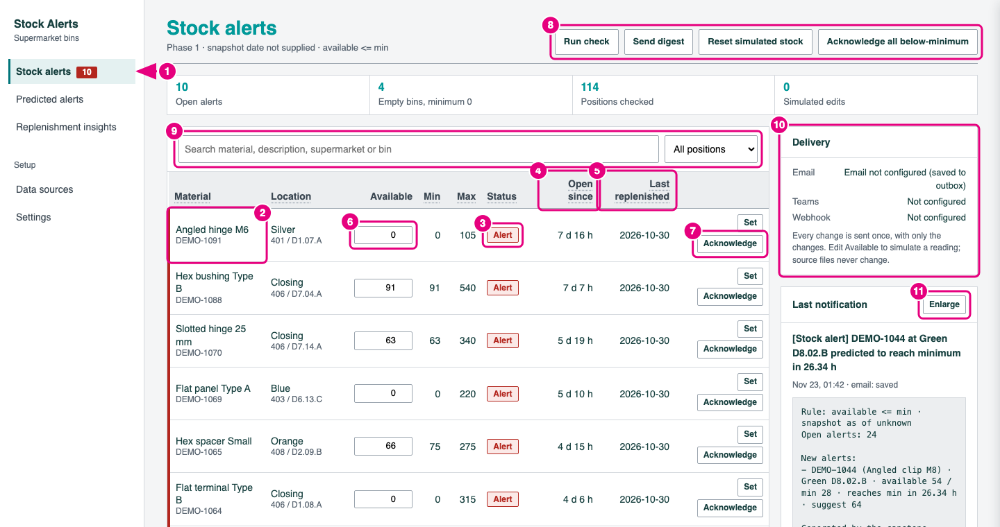

# Notification setup guide

How the app sends alerts, how to switch on email, Teams or a webhook, and how to check that it works. Short version: nothing is sent until you configure a channel. Without one, every alert is saved as an email file on disk.

## 1. What triggers a notification

A notification is sent whenever the set of alerts **changes**, whatever caused the change:

- a bin falls to or below its minimum (a *below-minimum* alert opens)
- a bin is forecast to reach its minimum within lead time plus safety buffer (a *predicted* alert opens)
- a bin recovers (an alert resolves)
- a new stock or Min/Max file is imported, a simulated stock edit is made, settings are applied, or **Run check** is pressed
- **Send digest** is pressed: one summary of **all** open alerts, even if nothing changed
- every N minutes, if the server was started with `--check-minutes N`

Each change is sent once, with only the changes in it. Pressing **Run check** twice does not send the same alert twice.

## 2. Channels

| Channel | Status | Where it goes |
| --- | --- | --- |
| **Email file** (default) | Works, tested | A `.eml` file in `outputs/outbox`, one per notification. Open it with any mail program. |
| **Email (SMTP)** | Works, tested with a fake server only | The addresses in `ALERT_EMAIL_TO`. If sending fails, the message is saved to the outbox instead, so it is not lost. |
| **Microsoft Teams** | Built and unit-tested, **not tested against a real Teams tenant** | A Teams Workflows webhook, as an Adaptive Card |
| **Generic webhook** | Works, unit-tested | Any URL that accepts a JSON `POST` |

The **Delivery** panel on Stock alerts shows which channels are configured. Teams and Webhook say *Connected* or *Not configured*. Email says whether it is configured or saved to the outbox. The panel shows configuration only; it does not prove the receiver accepted a message. Use **Send digest** for that (section 4).



In the picture above, label 10 is the Delivery panel and label 11 opens the last notification in a larger window.

## 3. Configure a channel

Set environment variables **before** starting the server. They are read at start-up, so restart after any change. Never commit credentials.

| Variable | Meaning | Default |
| --- | --- | --- |
| `SMTP_HOST` | Mail server host. Email is "configured" when this and `ALERT_EMAIL_TO` are both set. | empty |
| `SMTP_PORT` | Port. 465 switches to SSL. | 587 |
| `SMTP_USER`, `SMTP_PASSWORD` | Login, if the server needs one | empty |
| `SMTP_STARTTLS` | Set `0` to turn STARTTLS off (only without a password) | on |
| `SMTP_SSL` | Set `1` to use SSL from the start | off |
| `ALERT_EMAIL_FROM` | Sender address. Falls back to `SMTP_USER`, then `stock-alerts@localhost`. | |
| `ALERT_EMAIL_TO` | Recipients, comma-separated | empty |
| `TEAMS_WEBHOOK_URL` | Teams Workflows webhook URL | empty |
| `ALERT_WEBHOOK_URL` | Generic webhook URL | empty |
| `ALERT_DASHBOARD_URL` | Link added to messages ("Open dashboard") | empty |
| `ALERT_RULE` | `at_or_below` (available ≤ min) or `below` (available < min) | `at_or_below` |
| `ALERT_OUTBOX` | Folder for saved `.eml` files | `outputs/outbox` |

Lead times and the safety buffer (`LEAD_HOURS_STOCKED`, `LEAD_HOURS_FAB`, `ALERT_SAFETY_HOURS`, `ALERT_WATCH_HOURS`) decide **when a predicted alert fires**; they are normally set on the Settings page.

### Email

```
export SMTP_HOST=smtp.example.com
export SMTP_USER=alerts@example.com
export SMTP_PASSWORD='...'
export ALERT_EMAIL_FROM=alerts@example.com
export ALERT_EMAIL_TO=lead@example.com,foreman@example.com
.venv/bin/python server.py
```

Windows (PowerShell): `$env:SMTP_HOST = "smtp.example.com"` and so on, then `.venv\Scripts\python server.py`.

The app verifies the server's certificate. It **refuses to send a password without TLS**: leave `SMTP_STARTTLS` on, or set `SMTP_SSL=1`.

### Microsoft Teams

1. In the Teams channel, add a **Workflow** from the template "Post to a channel when a webhook request is received" and copy its URL.
2. `export TEAMS_WEBHOOK_URL='https://...'` and restart the server.
3. Confirm **Teams: Connected** on the Delivery panel, then send a digest.

Full click-through with screenshots of the Teams side: [teams-setup.md](teams-setup.md). The team ran out of time before testing this against a real tenant. If the card does not appear, check the Workflow's run history in Teams first.

### Generic webhook

`export ALERT_WEBHOOK_URL='https://...'`. The app sends a `POST` with `Content-Type: application/json` and this body (10 second timeout, one attempt, no retries):

```
{
  "run_id": "…", "created_at": "2026-11-23T14:02:11+00:00", "dataset": "xlsx-…",
  "rule": "available <= min", "snapshot_as_of": "2026-10-22",
  "summary": {"open": 74, "new": 1, "resolved": 0, "predicted": 12, "below_min": 62, "by_supermarket": {"Green": 20}},
  "new":      [ {"material": "…", "description": "…", "supermarket": "…", "bin": "…", "available": 3, "min": 5, "kind": "below_min"} ],
  "resolved": [ … ],
  "dashboard_url": null
}
```

A predicted alert also carries `hours_to_min`. A 2xx reply counts as delivered; anything else is reported as failed.

## 4. Check that it works

1. Start the server with your variables. The Delivery panel should show the channel as configured.
2. On **Stock alerts**, press **Send digest**.
3. Look in the mailbox or the Teams channel. If nothing arrives, open **Data sources** and read **Recent activity**: each notification is logged with the result per channel, for example `email saved` or `teams failed`.
4. You can also check `outputs/outbox` for the saved `.eml` file.

## 5. What a message contains

- **Subject:** `[Stock alert] <material> at <supermarket> <bin> is at or below minimum (+N more)` for a below-minimum alert, or `… predicted to reach minimum in <h> h` for a predicted one.
- **Body:** the rule and snapshot date, the open-alert count, then tables for *New alerts*, *Resolved* and, for a digest, *All open alerts*. Each row has material, description, supermarket, bin, available, minimum and a note (hours to minimum and a suggested quantity for predicted alerts).
- **Email** is sent as plain text and HTML. **Teams** shows the first 15 rows per section and "+N more".

## 6. When delivery fails

| What happened | What the app does |
| --- | --- |
| SMTP send fails | The message is saved as an `.eml` in the outbox. Recent activity on Data sources records `email failed`. |
| Webhook or Teams returns an error or times out | Recorded as `failed`. **No retry.** The next change sends the next message. |
| The outbox folder cannot be written | Recorded as `outbox failed`. |
| Any failure | The alert and the page are not affected. Passwords and webhook URLs are replaced with `***` in error messages. |

Because there is no retry, a missed webhook message is not resent. Send a digest to catch up.

## 7. Limits and ideas

- No per-user recipients, schedules, quiet hours or escalation by age. Everyone on `ALERT_EMAIL_TO` gets everything.
- No retries or delivery receipts.
- Teams was not tested end to end.
- A live data feed would raise the number of alerts that change. Add a rate limit per bin and alert hysteresis first ([Live data integration](LIVE_DATA_INTEGRATION.md)).
