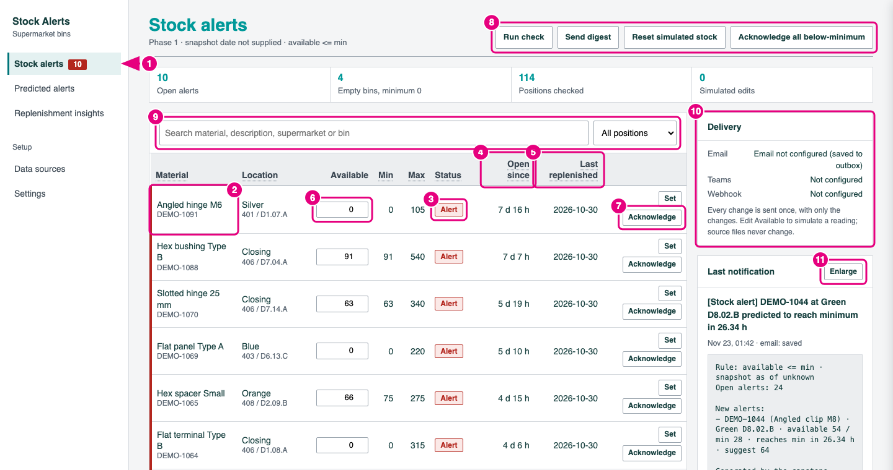
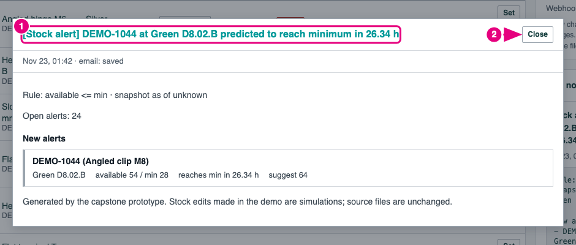
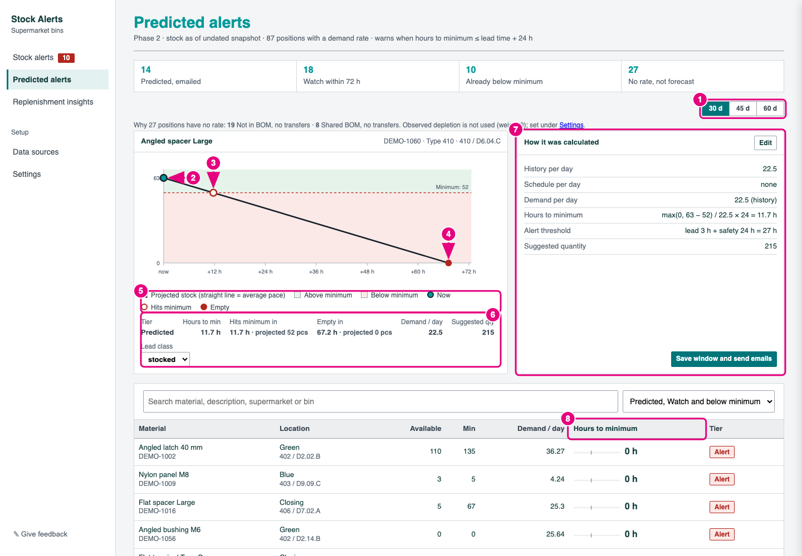
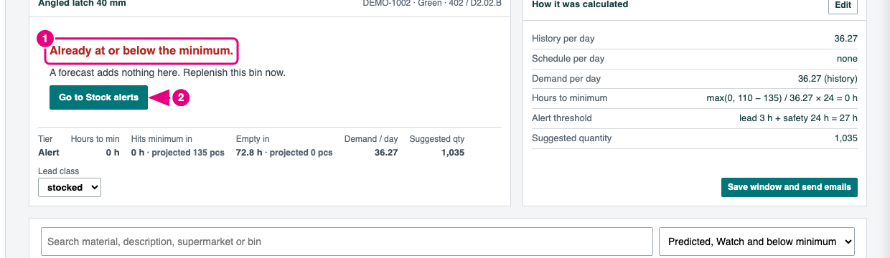
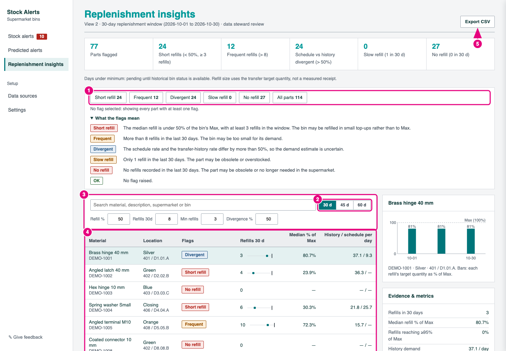
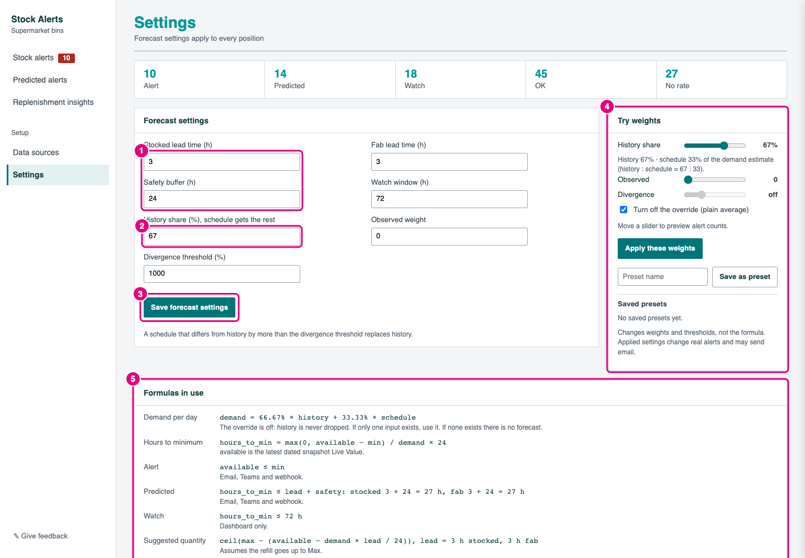
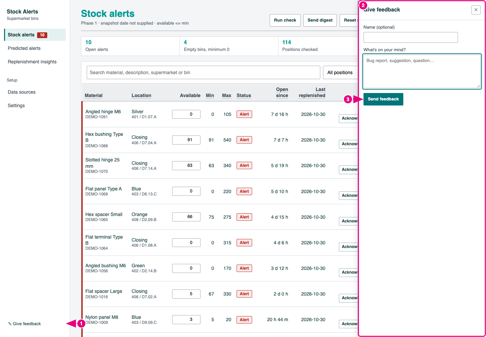

# User guide

What each screen shows and how to use it. To install and load data first, see the [Install guide](INSTALL_GUIDE.md). Screenshots use invented demo data. Numbers in the pictures match the numbered lists below them.

## The idea in one minute

Each supermarket bin has a **minimum** and a **maximum**. The app answers two questions:

- **Which bins are already at or below the minimum?** Those need a refill now. They are on **Stock alerts**.
- **Which bins will get there soon?** The app estimates how many hours until each bin reaches its minimum, from recent refill history and the production schedule. Those are on **Predicted alerts**.

A third page, **Replenishment insights**, flags parts whose refills look odd (too small, too frequent, too rare).

| Page | Use it to |
| --- | --- |
| Stock alerts | Act now: see bins at or below minimum, acknowledge them, send notifications |
| Predicted alerts | Plan ahead: see how many hours each bin has, and why |
| Replenishment insights | Review: find parts with refill problems, export a CSV |
| Data sources | Load the Siemens files (see the Install guide) |
| Settings | Change lead times, safety buffer and the demand weights |

The forecast is an estimate from recorded transfer quantities and the production plan. It is a straight-line projection, not a measurement of consumption, and it has not been checked against real stockouts. Use it to prioritise, not as a guarantee.

## Stock alerts

1. **Menu badge.** The red number is the count of open below-minimum alerts that nobody has acknowledged. It is visible on every page and disappears at 0.
2. **Red marker.** A red bar on the left of a row means the bin is in alert. It stays after you acknowledge, so you can still see which bins are low.
3. **Status.** *Alert* means available ≤ minimum. Other states are *Predicted*, *Watch* and *OK*. *Acknowledged* appears under the tag once someone has seen it.
4. **Open since.** How long the alert has been open. The list is sorted longest first. Click the heading to sort ascending, then back to the default. This is when the tool detected the breach, not when stock actually fell.
5. **Last replenished.** The date of the most recent recorded refill for that bin. A dash means no refill is on file. Click to sort.
6. **Available.** The current stock. You can type a lower number and press Enter (or **Set**) to simulate a reading and see an alert open. Nothing in the source files changes.
7. **Acknowledge.** Marks one alert as seen. It does not change stock.
8. **Header buttons.**
   - **Run check:** re-check every bin and notify about new alerts.
   - **Send digest:** send one summary of all open alerts.
   - **Reset simulated stock:** undo every simulated *Available* edit.
   - **Acknowledge all below-minimum:** mark all open below-minimum alerts as seen.
9. **Search and filter.** Find a part, description, supermarket or bin. The filter shows *All positions*, *Alerts*, *OK* or *Simulated edits*.
10. **Delivery.** Shows whether email, Teams and a webhook are configured. If they are not, alerts are saved as files (see the Install guide).
11. **Enlarge.** Opens the latest notification in a larger window.

Click a column heading to sort. Open since and Last replenished sort with empty values last.

### Reading a notification

**Last notification** (right side) shows the most recent message. Press **Enlarge** to read it in a dialog.

1. The subject: what happened and for which part and bin.
2. **Close.** Esc and a click outside the window also close it.

The body lists each new alert with the part, bin, available, minimum, hours to minimum and a suggested quantity.

## Predicted alerts

Pick a row in the table to see its forecast.

1. **Rate window (30 / 45 / 60 days).** How many days of refill history set the demand rate. Clicking previews the result without saving. **Save window and send emails** (right panel) stores it and sends any new alerts.
2. **Now (teal dot).** Today's available stock.
3. **Hits minimum (hollow red dot).** When the straight line reaches the minimum.
4. **Empty (solid red dot).** When it reaches zero.
5. **Legend.** The green area is above the minimum, the red area below it. The horizontal axis is *hours from now*. The snapshot has no time of day, so there are no clock times.
6. **Numbers under the chart.** Tier, hours to minimum, the hours to hit the minimum and to be empty, demand per day, suggested quantity, and the lead class (*stocked* or *fab*).
7. **How it was calculated.** The inputs and arithmetic for this bin. The formulas are in [formulas.md](formulas.md).
8. **Hours to minimum column.** The key number for planning. It is bold in the table so it is the first thing to read.

The tiers:

| Tier | Meaning (defaults) |
| --- | --- |
| Alert | Available ≤ minimum |
| Predicted | Hours to minimum ≤ lead time + safety buffer (3 h + 24 h = 27 h). Emailed. |
| Watch | Hours to minimum ≤ 72 h. Shown on the dashboard only. |
| OK | More than 72 h |
| No rate | No refill history and no schedule for the part, so no forecast. The reason is shown under the tier. |

### A bin that is already in alert

If a bin is already at or below its minimum, a forecast would show nothing. The chart is replaced by a short message and a button.

1. Message: the bin needs a refill now.
2. **Go to Stock alerts.** Takes you to the page where you acknowledge and act.

## Replenishment insights

1. **Flag buttons.** Click one to filter the table. *Short refill*: refills are small compared with the bin maximum. *Frequent*: more than 8 refills in 30 days. *Divergent*: schedule and history disagree by more than 50%. *Slow refill*: only one refill in 30 days. *No refill*: none in 30 days (the part may be obsolete). Open **What the flags mean** for the exact rules.
2. **Window (30 / 45 / 60 days).** The same toggle as on Predicted alerts. It changes how many days of history the per-day rates in the table use.
3. **Search and thresholds.** Change the limits live: refill %, refills in 30 days, minimum refills and divergence %.
4. **Parts table.** Click a row for its refill history chart and evidence on the right.
5. **Export CSV.** Download the flagged parts.

## Settings

1. **Lead times and buffer.** Hours to restock a stocked part and a fab part, and the extra safety hours.
2. **History share.** How much of the demand estimate comes from refill history; the rest comes from the production schedule. The default is 2 : 1 (67 %).
3. **Save forecast settings.** Applies the change to every bin. Applied settings change real alerts and can send email.
4. **Try weights.** Move the sliders to preview how many bins would change tier before you save. **Save as preset** keeps a named set to apply later.
5. **Formulas in use.** The live formulas with your current numbers. The formulas themselves are fixed.

## Data sources

Loads the Siemens files and shows what was loaded and how well it joins. Steps are in the [Install guide](INSTALL_GUIDE.md#4-load-data).

## Give feedback

Use **Give feedback** at the bottom of the menu on any page.

1. Opens the form.
2. Write a bug, suggestion or question. A name is optional.
3. **Send feedback** saves it in the local database for the team that maintains the tool. It is not emailed.

## Limits to know

- The forecast is not validated against real stockouts. Only the daily demand rate was tested on held-out transfers.
- Demand comes from transfer target quantities and the plan, not from measured consumption.
- Open since restarts if the database is re-imported.
- Stock edits made with **Available** are simulations. They never change the source files.
- Single user, no login, this computer only.
